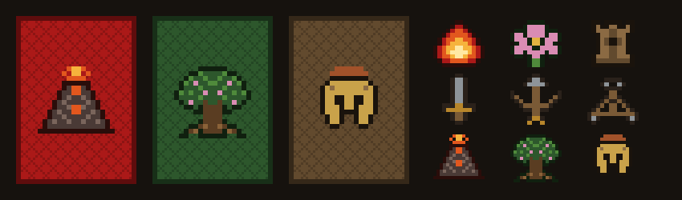

# Paradigwent · Taller



Arte y datos de **Paradigwent**, el juego de cartas del TP1 de Paradigmas de la
Programación (FIUBA): un Gwent simplificado en Java y JavaFX con tres facciones,
**Draconiens**, **Lothrim** y **Hoplitas**.

Este repo no tiene lógica del juego. Tiene lo que el juego carga: las 90 cartas en JSON,
las ilustraciones en pixel art, los dorsos, las piezas del tablero y los sonidos, junto
con los scripts que los generan.

## Las facciones

| Facción | Quiénes son | Su poder | Color | Línea fuerte |
|---|---|---|---|---|
| **Draconiens** | Hombres dragón de Arx Infera, una ciudadela dentro de un volcán | El fuego del centro de la tierra | Rojo | Cuerpo a cuerpo |
| **Lothrim** | Elfos del pueblo de la flor, guardianes del árbol Galadloth | La naturaleza | Verde | Distancia |
| **Hoplitas** | Humanos de Siderópolis, la ciudad de hierro | El ingenio: máquinas, forja y bestias domadas | Marrón | Asedio |

Cada facción tiene 30 cartas (23 criaturas comunes, 2 con habilidad, 2 de efecto y 3 de
clima), con nombres en su propio idioma: latín y francés, sindarin y griego.

## Qué hay

| Carpeta | Contenido |
|---|---|
| `datos/` | Las cartas, las paletas de cada facción y los textos para generar ilustraciones |
| `assets/` | Lo que usa el juego: ilustraciones, dorsos, piezas del tablero y sonidos |
| `taller/` | Los scripts en Python que generan los assets |
| `scripts/` | Instalación y arranque de ComfyUI |
| `pruebas/` | Ilustraciones candidatas, para elegir antes de pasarlas a `assets/`, y sonidos descartados |
| `docs/` | Documentación |

## Empezar

Hace falta [uv](https://docs.astral.sh/uv/), que instala Python y las dependencias.

```bash
git clone https://github.com/FlorianLucchini/paradigwent-taller
cd paradigwent-taller
uv sync
uv run python -m taller.pintar   # dibuja los dorsos y las piezas en assets/
```

Generar ilustraciones necesita además una placa de video NVIDIA (con 4 GB alcanza) y
ComfyUI, que se instala con `scripts/comfyui.sh instalar`. El paso a paso está en
[docs/uso.md](docs/uso.md).

## Documentación

- [Uso](docs/uso.md): cómo generar cada cosa y cómo agregar o cambiar una carta.
- [Herramientas](docs/herramientas.md): qué se instala, para qué sirve y qué licencias tiene.
- [Formatos](docs/formatos.md): los archivos de `datos/` y cómo están guardados los assets.

## Autor y licencia

Florian Lucchini.

El código está bajo [licencia MIT](LICENSE). Las imágenes, los datos y los sonidos están
bajo [CC BY 4.0](https://creativecommons.org/licenses/by/4.0/deed.es): se pueden usar
citando al autor. Las ilustraciones de las cartas están generadas con IA (Stable
Diffusion).

La música de fondo y los sonidos de victoria, derrota y fin de ronda citan, pasados a
8 bits, riffs de canciones de **Patricio Rey y sus Redonditos de Ricota** (Carlos Solari
y Eduardo Beilinson): *El pibe de los astilleros*, *Ya nadie va a escuchar tu remera*,
*Semen-up* y *Rock para los dientes*. Esos fragmentos son un homenaje, siguen siendo de
sus autores y no quedan bajo CC BY 4.0.
